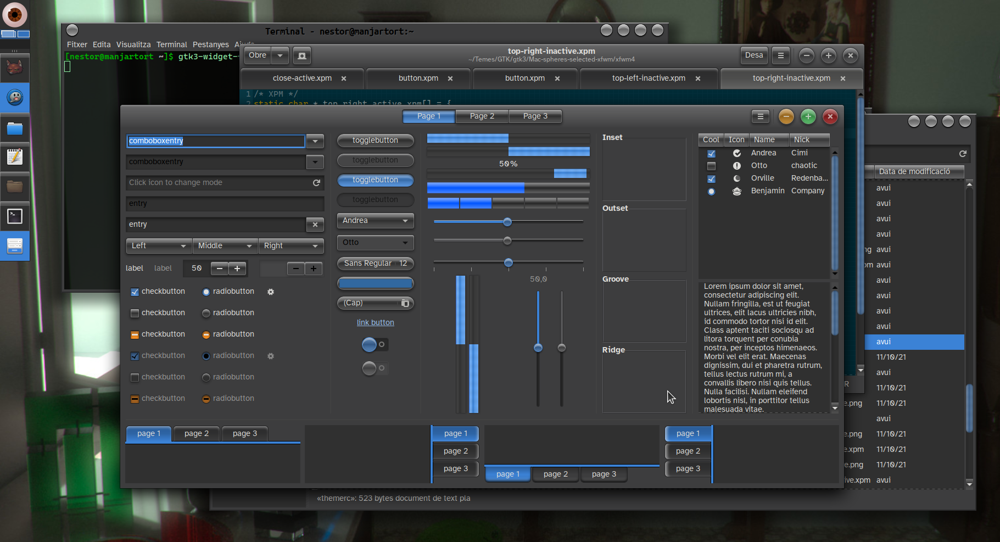
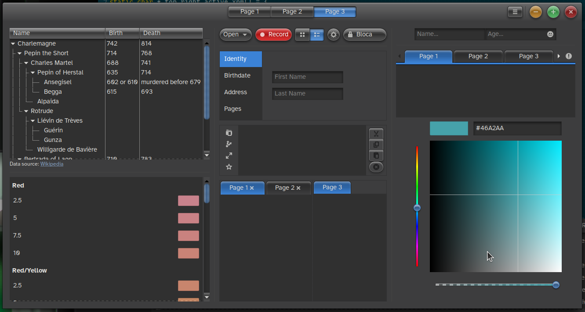
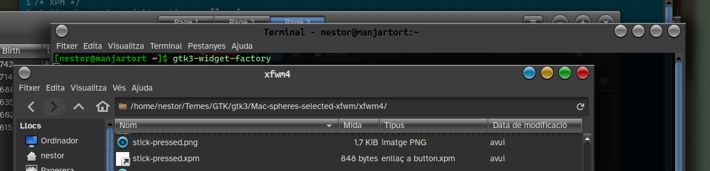

# Mac-OS-X-Cheetah-dark

Darkened and tuned version of Mac OS X Cheetah theme based on Azurra Framework Mac OS X. It is a skeuomorphic, shiny, dark theme, with blue accents. Very easy on the eyes. Disabled elements have black text/icons, in order to perceive this status quickly.

It includes GTK3, gtk2, xfwm4 and metacity themes. xfwm4 theme created from scratch.

Despite lacking preview image, this theme should work for Mate too.

It does **not** include Gnome Shell or Cinnamon theme.

For KDE Plasma / Qt integration, I suggest using Kvantum with KvSimplicityDark theme. With time I could create a really matching one.

Metacity theme copied from someone else's theme, but I can't remember which or whose, sorry about that.

I've added a Kvantum theme for Qt apps (or desktops such as KDE Plasma or LXQt)

## Previews

